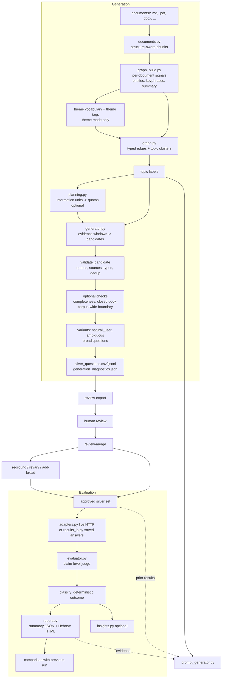

# Alloy design: overview

Part of the Alloy design reference; index and invariants in [../ARCHITECTURE.md](../ARCHITECTURE.md). Citations such as [R1] are listed in [references.md](references.md).

The files in `docs/design/` explain how Alloy (`chatbot_eval`) works internally, component by component, and why
it is built the way it is. It is written for data scientists and engineers who need to trust,
extend, or audit the numbers Alloy produces. The [README](../../README.md) remains the operational
manual (commands, parameters, file formats); these files are the design reference.

A note on the "why" sections: the rationale is reconstructed from the code, its comments and tests,
the commit history, and the review notes in `docs/archive/`. Where a decision is an inference rather than
something the code or docs state, it is marked *(inferred)*. References are listed in [references.md](references.md) and
cited inline as [R1], [R2], and so on.

## 1. What Alloy does, in one page

Alloy has two halves that share data contracts but no runtime state:

- **Generation** turns a folder of internal documents into a *silver* evaluation set: Hebrew
  questions with reference answers, atomic reference claims, cited source chunks, and verbatim
  supporting quotes. "Silver" means machine-generated and deterministically validated, but not yet
  ground truth; a domain expert approves each row before it gates anything.
- **Evaluation** sends approved questions to a chatbot (or reads previously saved answers), has an
  LLM judge score each answer claim by claim, turns the scores into one outcome per question with
  deterministic code, and aggregates outcomes into a Hebrew HTML report with confidence intervals and
  run-to-run comparison.

Two smaller components hang off these: a **system-prompt generator** that drafts a reviewable Hebrew
chatbot prompt from the same corpus and prior evaluation results, and **insights**, an optional
cross-result analysis of failure patterns.

The one idea that explains most of the design: **every model output is treated as a proposal, and
code decides what is accepted.** Questions are kept only if their quotes are found verbatim in the
cited chunks; judge scores are reduced to outcomes by a fixed decision procedure; prompt packages are
checked against a deterministic list of requirements. The LLM does the language work and the code
owns the guarantees.

## 2. System map

Module dependencies follow the same direction. `models.py` (Pydantic contracts) and `validation.py`
(invariants at input boundaries) are shared by everything; `cli.py` is the only module that wires
components together, so each component can be tested with fakes (the whole test suite runs offline).

## 3. Design principles that cut across every component

These are visible in almost every module, and most of them are written into
[AGENTS.md](../../AGENTS.md) as rules for contributors.

**3.1 Documents, questions, and answers are untrusted data.** Every prompt says so explicitly and
asks the model not to follow instructions inside the supplied text. Indirect prompt injection is the
dominant threat for any system that pastes retrieved text into a prompt [R22]; delimiting and
labelling untrusted spans is one of the few prompt-level mitigations with measured effect [R23].
Alloy also never exposes tools to the model (automatic function calling is explicitly disabled), so
an injected instruction has nothing to act on beyond the structured response itself, and that
response is validated by code.

**3.2 Structured output, then deterministic validation.** Every model call returns a Pydantic schema
through Gemini's JSON-schema mode, and every accepted object passes code checks. A rejection is never
silent: it is counted under a named reason (`quote_not_verbatim`, `duplicate`,
`boundary_answerable_in_corpus`, ...) in `generation_diagnostics.json`. This mirrors the "generate,
then filter by consistency" recipe of synthetic QA corpora [R5], with the filter made explicit and
auditable instead of being a second model.

**3.3 Hebrew output, Hebrew-aware matching.** Every prompt asks for Hebrew output. Matching code
(entity keys, quote checks, BM25 tokens, near-duplicate detection) normalizes niqqud, gershayim and
geresh (`צה"ל` / `צה״ל`), Unicode compatibility forms, bidi control marks, and some attached one-letter
prefixes. Hebrew's rich morphology is the main reason off-the-shelf English text processing
underperforms [R24]; Alloy deliberately uses a light, rule-based normalization rather than a
morphological analyzer *(inferred: no dependency, deterministic, cache-stable)*.

**3.4 Reproducibility as a feature.** Every structured call is seeded (`gemini.seed`, default 7),
topic workers are independent and merged in a fixed order, IDs are content hashes, and long runs are
checkpointed. The same documents, settings, and seed reproduce the same question set, and
`--max-concurrency` does not change the result. This makes it possible to change one thing (a
prompt, a threshold) and attribute the difference.

**3.5 Pay once for every model call.** Expensive work is content-addressed and cached at several
levels (per-document signals, graph, every seeded call, embeddings), and run journals let an
interrupted run resume without re-paying. See [section 9](caching.md#9-caching-identity-and-invalidation-cachepy-contractspy).

**3.6 Optional checks cost money, so they are off by default and always reported.** Completeness
verification, corpus-wide boundary verification, closed-book checks, embeddings, and broad questions
all add calls; each is opt-in and records its outcome in the diagnostics.

**3.7 Errors are not quality.** Chatbot transport failures and judge failures become
`chatbot_error` / `judge_error` records and are excluded from every quality denominator. A gateway
outage must never look like a worse chatbot.
